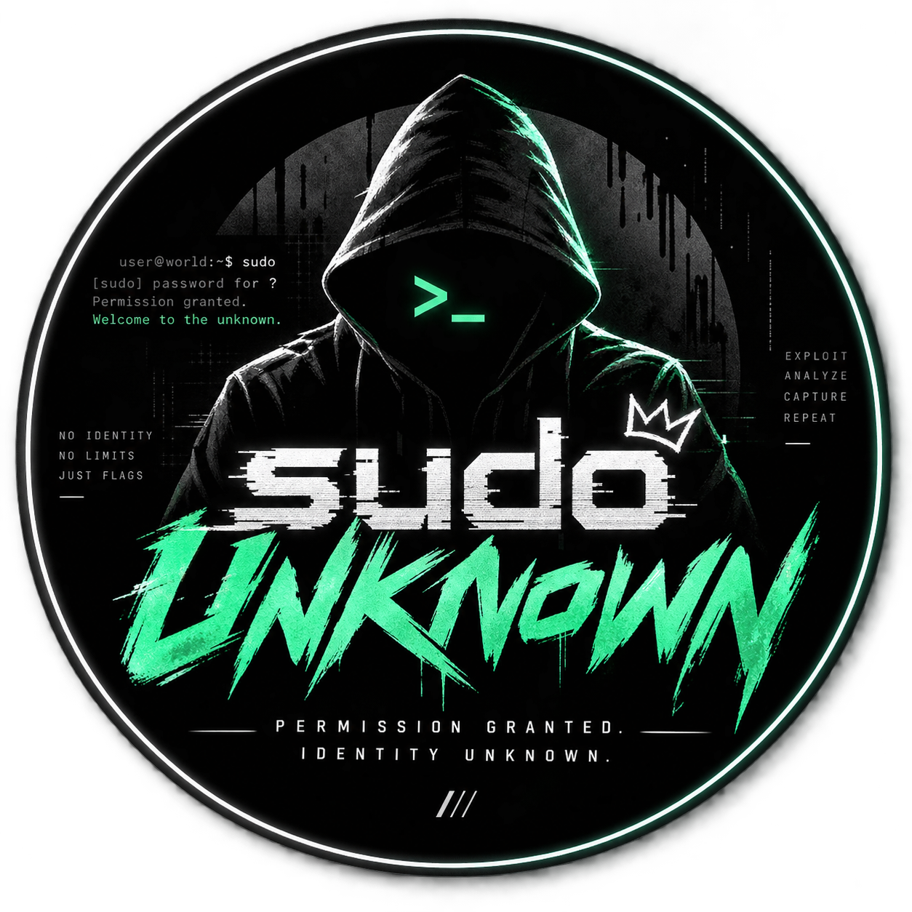

# sudo Unknown // All-in-One Cybersecurity Syndicate

<div align="center">
  
  <h3>Permission Granted. Identity Unknown.</h3>
  <p>
    <strong>RECON • COMPROMISE • EVADE • HARDEN</strong><br />
    <strong>EXPLOIT • ANALYZE • DEFEND • REPEAT</strong>
  </p>
  <p>
    An all-in-one cybersecurity collective, research syndicate, and competitive CTF squad.<br />
    Official Hack The Box Squad ID: <a href="https://ctf.hackthebox.com/team/overview/331386"><strong>#331386</strong></a>
  </p>
</div>

---

## 🛡️ About sudo Unknown

**sudo Unknown** is an all-in-one multidisciplinary cybersecurity collective, offensive research group, and competitive CTF squad. We bridge cutting-edge enterprise red teaming, vulnerability research, and custom exploit engineering with tournament domination across Hack The Box, TryHackMe, and global CTF arenas.

### ⚡ Core Operations & Pillars
- **Adversary Simulation & Red Teaming:** Multi-domain Active Directory attacks, Kerberoasting, DACL abuse, EDR evasion, and cloud metadata pivoting.
- **Vulnerability Research & 0-Day Discovery:** Memory corruption, GLIBC safe-linking bypasses, heap tcache exploitation, and reverse engineering custom bytecode VMs.
- **Dedicated HTB & CTF Writeups Hub:** In-depth, reproducible field reports with target intelligence, full attack chains, weaponized PoC code, captured flags, and defensive remediation playbooks.
- **Open-Source Tool Arsenal:** Custom attack suites and utilities (`sudo-recon`, `ad-acl-pivoter`, `jwt-tamper-cli`, `tcache-forger`, `shadow-carver`, `pyjail-hunter`).
- **Cyber Warfare Range & Challenge Design:** Turnkey vulnerable-by-design machines, containerized CTF challenges, and tournament scoring engines.

---

## 📖 HTB & CTF Writeups Explorer

The platform includes a dedicated **Field Writeups Repository** featuring real, reproducible debriefs:
- **DutyBound (Hack The Box - Windows AD / Medium):** Kerberoasting service accounts -> BloodHound GenericWrite DACL escalation -> Domain dominance via DCSync.
- **Takeoff (Hack The Box - Linux / Medium):** Flask Jinja2 SSTI character filter bypass -> Tar wildcard command execution for root.
- **Layover (Hack The Box - Cloud/Linux / Hard):** OAuth2 PKCE parameter downgrade -> Docker socket mount container breakout.
- **Frosted (Hack The Box - Windows Enterprise / Hard):** Microsoft Exchange ProxyLogon SSRF -> Volume Shadow Copy NTDS.dit extraction.
- **Quantum Lockout (HTB Challenge - Crypto / Medium):** Flawed PRNG timestamp seeding -> Pairwise GCD collision for instant RSA key factoring.
- **Safe-Linking Bypass (HTB Challenge - Pwn / Insane):** GLIBC 2.35 pointer mangling demangling -> Heap tcache poisoning -> One-gadget RCE.
- **Operation Cymbal (CTFtime - Web / Medium):** Evilginx3 Adversary-in-the-Middle phishing analysis -> Microsoft 365 token exfiltration.
- **Subverted ELF (HTB Challenge - Reverse / Hard):** Decompiling custom 8-opcode stack bytecode virtual machine interpreter.

---

## 🌟 Syndicate Roster & Recruitment

- **Founding Captain & Lead Researcher:** Asmit (SmitroniX)
- **Recruiting Founding Specialist Cohort:**
  - `[OPEN]` Web Exploitation Lead (OAuth, SSRF, Deserialization, API Security)
  - `[OPEN]` Binary Exploitation (PWN) Lead (GLIBC Heap, ROP, Kernel Exploits)
  - `[OPEN]` Active Directory & Enterprise Lead (Kerberos, AD CS, DACL Pathing)
  - `[OPEN]` Applied Cryptography Analyst (Lattice LLL, Curve Weaknesses, PRNGs)
  - `[OPEN]` DFIR & Network Forensics Lead (Volatility 3, Memory Triage, PCAP Carving)
  - `[OPEN]` Reverse Engineering Analyst (x86/x64 Assembly, Custom VMs, Firmware)

---

## 🛠️ Tech Stack & Architecture

- **Framework:** React 18 + TypeScript + Vite
- **Styling:** Tailwind CSS (Dark Obsidian Cyberpunk Theme)
- **Icons & Visuals:** Lucide React + Canvas Particle Background
- **Interactivity:** Full-screen interactive writeup reader modal, interactive CLI terminal drawer (`~` or `Ctrl+K`), live filters, and confetti animations.

---

## 🚀 Development & Build

```bash
# Install dependencies
npm install

# Start local development server
npm run dev

# Compile TypeScript & production bundle
npm run build

# Preview production build
npm run preview
```

---

## 🌐 Official Channels

- **Website:** [sudounknown.smitronix.dev](https://sudounknown.smitronix.dev)
- **Hack The Box Squad:** [Team #331386](https://ctf.hackthebox.com/team/overview/331386)
- **Discord War Room:** [discord.gg/HgD6WGUr4G](https://discord.gg/HgD6WGUr4G)
- **LinkedIn:** [sudo-unknown](https://www.linkedin.com/company/sudo-unknown/)
- **GitHub:** [SmitroniX/sudo-unknown](https://github.com/SmitroniX/sudo-unknown)
- **Contact:** [sudounknown@smitronix.dev](mailto:sudounknown@smitronix.dev)
